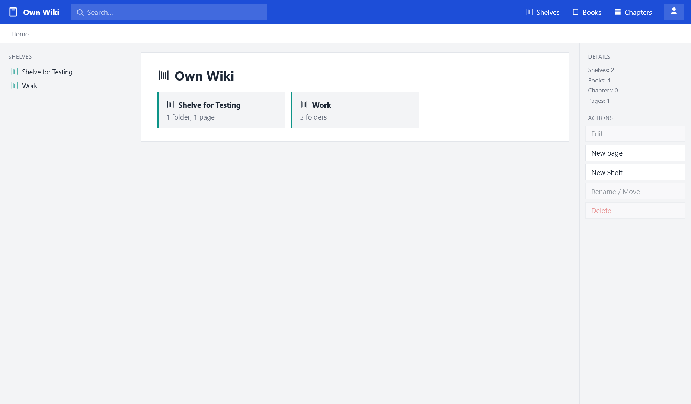
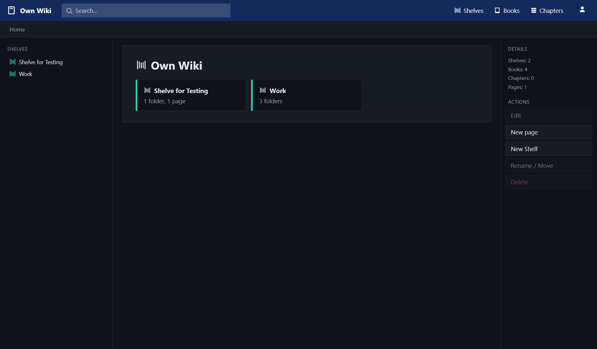
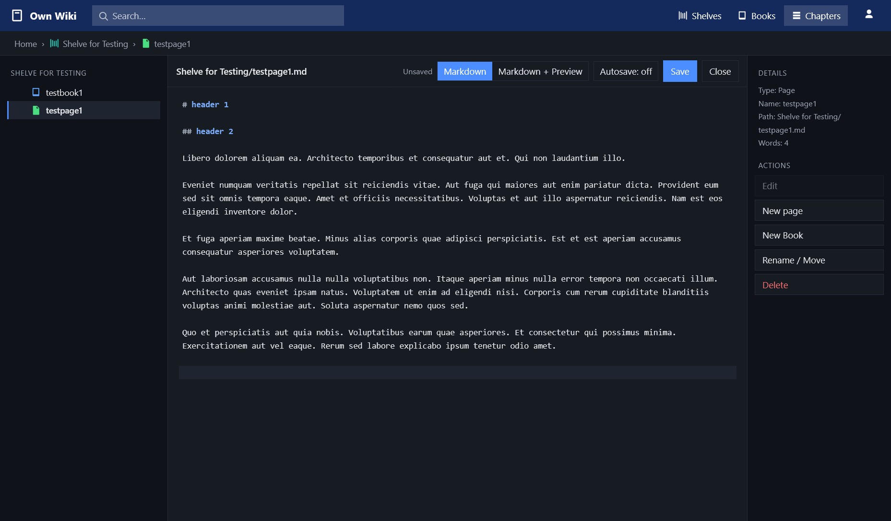
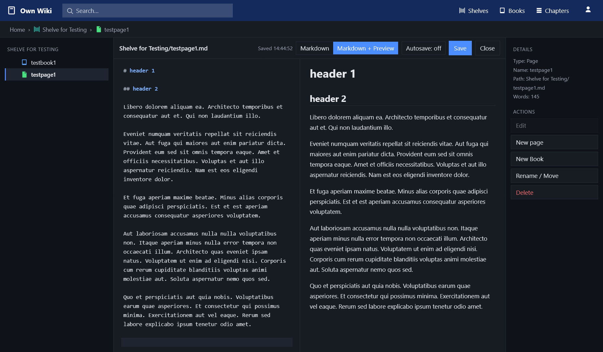

# md-wiki

Single-user wiki for Markdown. One password, no database: all pages are plain `.md` files in a folder.
Backup and export = copy the `data/` folder.

Looks like a small book shelf: **Shelves → Books → Chapters → Pages**, with a flat, square design
(sharp corners, light and dark theme).

<table>
  <tr>
    <td align="center">Light Mode</td>
    <td align="center">Dark Mode</td>
  </tr>
  <tr>
    <td></td>
    <td></td>
  </tr>
</table>
<table>
  <tr>
    <td align="center">No Preview</td>
    <td align="center">With Preview</td>
  </tr>
  <tr>
    <td></td>
    <td></td>
  </tr>
</table>

It has GitHub Flavoured Markdown (GFM), so it has more Features than normal Markdown.

## Getting started

**All commands run inside the `mdwiki/` folder (`cd mdwiki`).**

1. Copy `.env.example` to `.env` and set a strong password:
   `cp .env.example .env && chmod 600 .env`
2. Create the data folder with correct ownership (container runs as user `node`, UID 1000):
   `mkdir -p data && sudo chown 1000:1000 data`
3. `docker compose up -d --build`
4. Open `http://SERVER-IP:3100` in your browser and enter the password.

> **Note:** The two IPs in `docker-compose.yml` ports are the author's server IPs and must be changed to your own server IPs (or use `3100:3000` only for local tests).

Without Docker (for testing, Node 18+ required):
`APP_PASSWORD=secret DATA_DIR=./data node server.js`

## Structure

``` none
server.js            Backend (Node standard library only, no npm packages)
public/index.html    User interface
public/app.js        Frontend logic (login, tree, editor, search, own dialogs)
public/cm-editor.js  CodeMirror 6 editor glue module (lazy-loaded)
public/vendor/       marked + CodeMirror 6 (vendored, offline, no CDN)
test/smoke.js        Server tests (node test/smoke.js)
test/render.js       Markdown renderer + XSS tests (node test/render.js)
test/cm6-vendor.js   CM6 vendor integrity test (node test/cm6-vendor.js)
test/app-lint.js     app.js lint for `$("#...")` bug (node test/app-lint.js)
tools/fetch-cm6.mjs  Downloads and verifies CM6 vendor packages (node tools/fetch-cm6.mjs)
public/style.css     Appearance (square design, light/dark switchable)
Dockerfile
docker-compose.yml
data/                your pages (created on startup, mounted as a volume)
data/assets/         uploaded images
```

## Update

`git pull`, then `docker compose up -d --build` in `mdwiki/`. A plain `docker compose restart` is NOT enough because `public/` is baked into the image.

## Mobile layout

The mobile layout is read-only on purpose; edit on the desktop layout.

## Configuration (environment variables)

| Variable | Default | Meaning |
| --- | --- | --- |
| `APP_PASSWORD` | (required) | The one and only password |
| `PORT` | 3000 | Port inside the container |
| `DATA_DIR` | `./data` (`/data` in the image) | Folder containing the pages |
| `COOKIE_SECURE` | false | Set to `true` as soon as HTTPS is in front (e.g. `tailscale serve`), otherwise login over HTTP won't work |

Sessions are stored (as hashes) in `data/.sessions.json`, so a container restart does not log you out.

## Backup

- The account menu has "Download backup" (downloads `data/` as `.tar.gz`, without `.sessions.json`).
- For automatic backups on the server use cron, for example this line (adjust the paths):
  `0 3 * * * tar czf /path/to/backups/own-wiki-$(date +\%F).tar.gz --exclude=".sessions.json*" -C /path/to/mdwiki/data .`
  Inside a crontab the `%` must be written as `\%`.
- Old backups should be deleted regularly, for example with `find /path/to/backups -name "own-wiki-*.tar.gz" -mtime +14 -delete`.

Continue with **GUIDE.md**.
